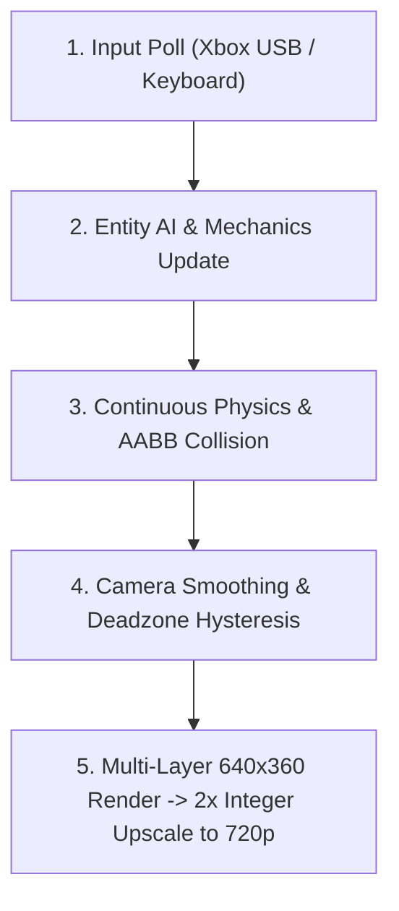
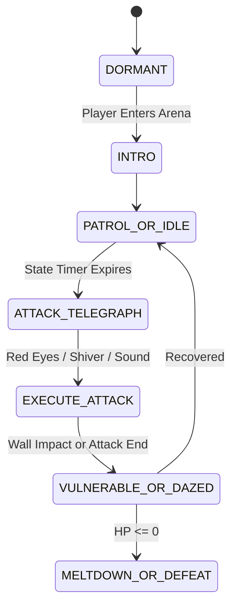

# 🐸 The Complete Froggy Game Dev Walkthrough & Nephew Guide
*From a Humble 1-Screen Prototype to a Lush 16-Bit / 720p Metroidvania Adventure*

---

## 🌟 1. Welcome to Froggy: How It Started & How It's Going

Hey there, game creator! If you are reading this, you are looking under the hood of a real, commercial-grade 2D retro action-adventure game. 

When your uncle first asked to build **Froggy**, the project started as a tiny experiment: a small pixel frog trying to grapple to a golden ring on a single static screen. But game development is like growing a giant jungle vine: once the core mechanic feels amazing in your hands, the world naturally expands around it!

Today, **Froggy** is a sprawling **720p 16-Bit Metroidvania** complete with:
- **9 interconnected rooms** spanning Sunlit Canopies, Sunken Temples, Bioluminescent Caverns, and a Freezing Glacial Peak.
- **4 Colossal Multi-Phase Bosses**: Emperor Mantis, The Dread Hound, Giga Toad, and Falo the Evil Snowman.
- **Fluid Amphibian Mechanics**: 8-way directional tongue whipping, true pendulum rope swinging, 4-way water swimming, and cold-blooded body thermoregulation.
- **A Standalone MIDI Music Engine**: Full Standard MIDI (.mid) tracks you can drag-and-drop right into any digital audio workstation (DAW) to compose your own songs!
- **Disk Save & Checkpoint Totems**: Full persistence saving your relics, health, and room progress to disk.

Let's walk through how every single gear inside this game turns, so you have full creative superpowers to modify, expand, and direct the game however you imagine!

---

## 🏛️ 2. The Engine Architecture: How It All Fits Together

A game engine is essentially a continuous loop that runs 60 times every second (**60 FPS**). In each frame (which lasts about **16.6 milliseconds**), the game executes five distinct phases in order:



### Component Breakdown
- [`SNESController`](file:///c:/AGProj/FroggyDemo/froggy_engine.py#L4878-L4980): Translates physical Xbox 360/Series controller inputs and keyboard presses into clean game actions (`jump_just_pressed`, `held["Y"]`, `get_dpad_vector`).
- [`FroggyPlayer`](file:///c:/AGProj/FroggyDemo/froggy_engine.py#L5010-L5640): Handles Froggy's state machine (`idle`, `run`, `jump`, `tongue`, `swim`, `swing`, `wall_slide`), inventory relics, health hearts, and body temperature.
- [`TileMapRoom`](file:///c:/AGProj/FroggyDemo/froggy_engine.py#L4088-L4713): Parses ASCII string maps into physical solid Rectangles, animated water, fireflies, grapple nodes, and spawns enemies.
- [`WorldManager`](file:///c:/AGProj/FroggyDemo/froggy_engine.py#L4719-L4835): Manages room transitions, fade-in/fade-out overlays, defeated boss persistence, and horizontal/vertical door links.
- [`RetroAudioEngine`](file:///c:/AGProj/FroggyDemo/froggy_engine.py#L400-L580): Handles hardware-accelerated MIDI playback with automatic fallback to procedural chiptune wave synthesis.
- [`SaveManager`](file:///c:/AGProj/FroggyDemo/froggy_engine.py#L3850-L3904): Serializes game state into human-readable JSON (`save_game.json`).

---

## ⚙️ 3. The 16-Bit Physics Secrets Explained

### A. The "Hold-to-Grapple" Pendulum Rope
In retro games like *Super Castlevania IV* or *Bionic Commando*, grapple mechanics feel best when you control them intuitively. 

When Froggy whips his tongue at a Golden Idol:
1. **Whip/Shaft Grazing Check**: The game calculates the minimum distance from the idol's center $(c_x, c_y)$ to the line segment between Froggy's mouth $(x_1, y_1)$ and the tongue tip $(x_2, y_2)$ using vector projection:
   $$t = \text{clamp}\left(\frac{(c - p_1) \cdot (p_2 - p_1)}{\|p_2 - p_1\|^2}, 0, 1\right)$$
   If the idol falls within 22 pixels of any part of the tongue shaft, it latches on!
2. **Hold-to-Grapple Rule**: Froggy only attaches if you are **holding down** the tongue button (`Xbox X/Y` or `Keyboard X/J`). As soon as you **let go**, Froggy instantly releases his grip and flings forward along the pendulum tangent velocity!
3. **Pendulum Physics**: Gravity torque pulls the swing angle towards the center:
   $$\alpha = -\frac{g}{L} \sin(\theta) + \text{pump\_force}$$
   Angular damping ($\times 0.992$) stabilizes the swing so it feels smooth rather than chaotic.

### B. Mario-Style Stomp Damage
When Froggy collects the **Stomping Boots Relic** (`'J'`), landing on top of an enemy crushes them:
- **Condition**: Froggy must be falling downward ($v_y > 0$) and his feet must intersect the top 12 pixels of the enemy's bounding box.
- **Rebound Impulse**: Upon impact, the enemy takes damage, and Froggy's vertical speed is instantly set to $v_y = -6.4$ (or $-7.0$ for bosses), giving him a massive rebound bounce that restores his double jump!

### C. Amphibian Thermoregulation (Glacial Biome)
Because frogs are cold-blooded amphibians (**ectotherms**), entering the icy world introduces survival physics:
- In freezing mountain air: Froggy's thermometer gauge gradually drains ($-0.12\%$ per frame).
- In steamy geothermal hot springs: Froggy's permeable skin absorbs warmth, rapidly recharging his thermometer ($+0.85\%$ per frame) while soothing his health.
- If body temperature reaches $0\%$, severe hypothermia sets in, flashing a HUD alert and dealing rapid frost damage every 75 frames (1.25 seconds)!

---

## 🎨 4. The 32-Bit Sprite & Autotiling Pipeline

To keep the game looking like a polished arcade title (reminiscent of *Legend of Mana* or *Rayman*) rather than jagged amateur pixel art, we built a dedicated asset pipeline in [`sprite_studio.py`](file:///c:/AGProj/FroggyDemo/sprite_studio.py) and [`generate_assets.py`](file:///c:/AGProj/FroggyDemo/generate_assets.py):

### A. The 32x32 Uniform Bounding Box Standard
Earlier versions suffered from slight sprite flickering because jumping and idling sprites had different pixel heights (24px vs 30px), which caused the sprite anchor to "jitter" relative to the physical hit box. We solved this permanently by:
1. Normalizing **all** player sprite frames to uniform $32 \times 32$ RGBA surfaces.
2. Anchoring the drawing position directly to the bottom-center of Froggy's physical physics box:
   ```python
   draw_x = int(player.center_x - sprite.get_width() * 0.5 - camera_x)
   draw_y = int(player.rect.bottom - sprite.get_height() - camera_y)
   ```

### B. 4-Bit Neighbor Bitmask Autotiling
Instead of manually placing 16 different wall corner and edge tiles by hand, the engine uses **bitmask autotiling**:
```
    North (1)
West (8)   East (2)
    South (4)
```
For each solid `#` block, the engine checks its 4 orthogonal neighbors and sums their values:
$$\text{Bitmask} = (N \times 1) + (E \times 2) + (S \times 4) + (W \times 8)$$
This produces a unique index from 0 to 15, instantly mapping each block to its correct seamless edge, corner, ceiling, or interior stone texture!

---

## 🎵 5. Composing Music: The MIDI System & Your DAW Guide

One of the coolest features we built for you is the **Standard MIDI File (SMF Format 1) Synthesizer** in [`midi_writer.py`](file:///c:/AGProj/FroggyDemo/midi_writer.py). 

Rather than locking the game into hardcoded audio samples, all 7 soundtrack themes are stored as standard `.mid` files in `assets/music/`:
1. `jungle_vivaldi_reggae.mid`: A Jamaican dub/reggae arrangement of Antonio Vivaldi's *The Four Seasons* (*Spring* / Allegro) at 138 BPM.
2. `boss_mantis.mid`: Gothic harpsichord and pipe organ cathedral battle at 144 BPM.
3. `boss_hound.mid`: Heavy industrial cybernetic groove with slap bass and distorted lead at 152 BPM.
4. `boss_toad.mid`: Funky brawler groove featuring slap bass and punchy brass hits at 118 BPM.
5. `boss_snowman.mid`: High-speed winter blizzard gallop at 156 BPM.
6. `ice_hot_springs.mid`: Serene Caribbean steel drum & ambient warm synth pad at 96 BPM.
7. `title_theme.mid`: Tropical 16-bit intro fanfare at 124 BPM.

### How to Compose Your Own Tracks for Froggy
You can open, edit, or completely replace any of these `.mid` files using any music production software:

| DAW / App | Platform | Cost | How to Use |
| :--- | :--- | :--- | :--- |
| **GarageBand** | macOS / iOS | Free | Drag `.mid` into a new project, select instruments, edit notes, and Export -> MIDI. |
| **BandLab** | Web / Chrome / Mobile | Free | Open web studio, import `.mid`, remix notes, export `.mid`. |
| **FL Studio** | Windows / Mac | Trial / Paid | File -> Import -> MIDI File. Draw notes in Piano Roll, File -> Export -> MIDI. |
| **Reaper** | Windows / Mac / Linux | Free Trial | Drag `.mid` directly onto a track. Edit in built-in MIDI editor. |
| **MuseScore** | Windows / Mac | Free Open Source | Open `.mid` as sheet music, write new melodies on staff, Export -> MIDI. |

> [!TIP]
> **General MIDI Instrument Cheat Sheet for 16-Bit Vibe**:
> - Channel 9 (in zero-indexed code): Always reserved for the **General MIDI Drumkit** (Bass Drum = note 36, Snare = 38, Closed Hat = 42, Open Hat = 46).
> - Program 16-23: Organs (Drawbar Organ = 16, Rock Organ = 18, Church Organ = 19).
> - Program 24-31: Guitars (Acoustic = 24, Electric Clean = 27, Overdrive = 29).
> - Program 32-39: Basses (Acoustic Bass = 32, Finger Bass = 33, Slap Bass = 36).
> - Program 114: Steel Drums (Pure tropical island feel!).

---

## 👹 6. Boss Design & AI Patterns

Each boss in Froggy follows the classic Nintendo / Konami rule: **Clear Telegraphing $\rightarrow$ Dangerous Attack Window $\rightarrow$ Vulnerability State**.



1. **The Emperor Mantis** ([`boss_sanctum`](file:///c:/AGProj/FroggyDemo/froggy_engine.py#L1407)):
   - *Phase 1-3*: Flies overhead, dives with scythe sweeps, launches crescent blades.
   - *Vulnerability*: Exposes glowing weak point pearl; whip with `[Y]` to yank and heal!
2. **The Dread Hound** ([`hound_sanctum`](file:///c:/AGProj/FroggyDemo/froggy_engine.py#L1452)):
   - *Mechanic*: Anchored to the right wall. Lunges violently across the cavern.
   - *Vulnerability*: Slams into the left wall and gets dazed for 3 seconds; jump on top of his head to stomp with Stomping Boots!
3. **Giga Toad** ([`toad_colosseum`](file:///c:/AGProj/FroggyDemo/froggy_engine.py#L1503)):
   - *Mechanic*: Muscular heavyweight brawler. Leaps into the air and triggers ground pounds with traveling shockwaves.
   - *Vulnerability*: Becomes exhausted and pants after heavy slams.
4. **Falo the Evil Snowman** ([`falo_arena`](file:///c:/AGProj/FroggyDemo/froggy_engine.py#L1730)):
   - *Mechanic*: Throws rolling snowballs and blizzard volleys. Detaches his razor carrot nose as a spinning boomerang.
   - *Vulnerability*: While his nose is detached, his head is bare; jump directly onto his crooked top hat to deal 2 stomp damage! Melts into slush upon defeat.

---

## 💾 7. Save / Checkpoint Architecture

The engine uses [`SaveManager`](file:///c:/AGProj/FroggyDemo/froggy_engine.py#L3850-L3904) to write a clean JSON dictionary to `save_game.json`:

```json
{
  "version": 1,
  "room_id": "frost_springs",
  "player_x": 464.0,
  "player_y": 160.0,
  "hp": 5,
  "body_temp": 100.0,
  "eaten_count": 18,
  "has_stomping_boots": true,
  "has_red_boomerang": true,
  "defeated_bosses": ["boss_sanctum", "hound_sanctum"],
  "visited_rooms": ["level_1", "entrance_hall", "chimney_tower", "grapple_cavern", "frost_ascent", "frost_springs"]
}
```

- **Checkpoint Totems (`'X'`)**: Placed on pedestals (such as in `frost_springs`). Walking into a totem triggers a restorative particle burst, heals Froggy to full health, restores warmth to $100\%$, and auto-saves progress to disk.
- **In-Game Pause Menu**: Pressing `START / ESC` allows you to select **SAVE TO DISK** anywhere.
- **Title Screen Continue**: If a save exists on disk, the Title Screen automatically offers **CONTINUE CHECKPOINT** as the first selected option.

---

## 🗺️ 8. Level Design & Custom Builder Mode

Want to design your own rooms? Froggy includes an in-game builder mode!
1. At the Title Screen, pick **CREATE LEVEL (SANDBOX BUILDER)**.
2. Controls:
   - **Left-Click**: Place solid stone `#` (autotiled automatically!).
   - **G + Left-Click**: Place Golden Frog Grapple Idol `G`.
   - **E + Left-Click**: Place Moss Beetle `E`.
   - **F + Left-Click**: Place Buzz Fly `F`.
   - **Right-Click**: Erase tile back to air `.`.
   - **P Key**: Exports the entire room as ready-to-paste Python ASCII code directly to your terminal!

---

## 🚀 9. Recommended Next Steps for the Next Dev Chat

Here are the highest-leverage features to tackle in your next session with a powerful model:

1. **Audio Synthesis of Sound Effects into MIDI/WAV**:
   - Currently, music is pure General MIDI, while sound effects are procedurally generated waveforms. Adding high-quality 16-bit sound effect samples (e.g. SNES-style reverb snaps) will make hits feel punchier.
2. **Additional Biomes**:
   - *Volcanic Magma Tubes* (where Froggy's amphibian skin overheats and needs cooling waterfalls).
   - *Sunken Submarine Grotto* (deep underwater exploration with swimming puzzles).
3. **Dialogue & Story NPCs**:
   - Add friendly swamp elder frogs with text speech bubbles to guide the player through the lore of the ancient frog kingdom.
4. **Boss Rush & Speedrun Timer**:
   - An arcade time-attack mode challenging players to defeat all four bosses back-to-back with an in-game split timer.
