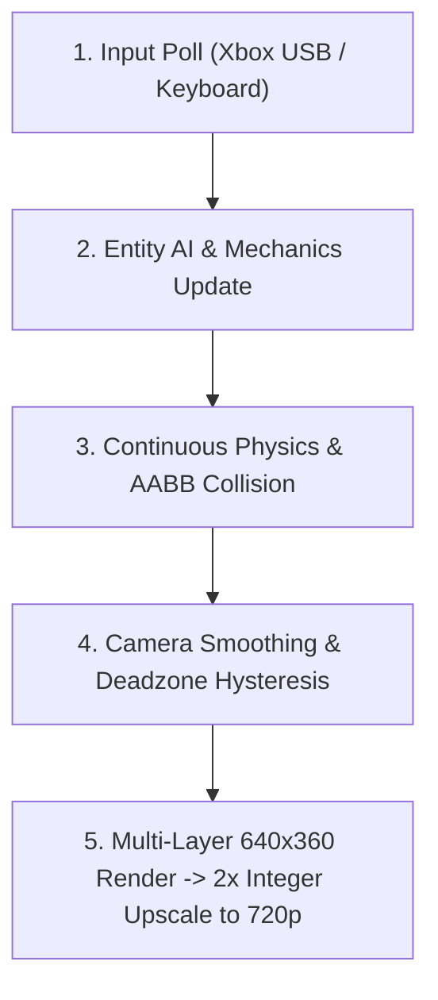
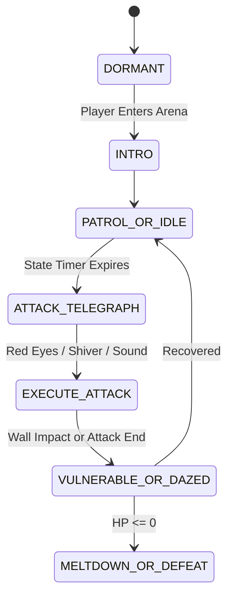

# 🐸 The Complete Froggy Game Dev Walkthrough & Nephew Guide
*From a Humble 1-Screen Prototype to a Lush 16-Bit / 720p Metroidvania Adventure*

---

## 🌟 1. Welcome to Froggy: How It Started & How It's Going

Hey there, game creator! If you are reading this, you are looking under the hood of a real, commercial-grade 2D retro action-adventure game. 

When your uncle first asked to build **Froggy**, the project started as a tiny experiment: a small pixel frog trying to grapple to a golden ring on a single static screen. But game development is like growing a giant jungle vine: once the core mechanic feels amazing in your hands, the world naturally expands around it!

Today, **Froggy** is a sprawling **720p 16-Bit Metroidvania** complete with:
- **9 interconnected rooms** spanning Sunlit Canopies, Sunken Temples, Bioluminescent Caverns, and a Freezing Glacial Peak.
- **4 Colossal Multi-Phase Bosses**: Emperor Mantis, The Dread Hound, Giga Toad, and Falo the Evil Snowman.
- **Fluid Amphibian Mechanics**: 8-way directional tongue whipping, true pendulum rope swinging, 4-way water swimming, and cold-blooded body thermoregulation.
- **A Standalone MIDI Music Engine**: Full Standard MIDI (.mid) tracks you can drag-and-drop right into any digital audio workstation (DAW) to compose your own songs!
- **Disk Save & Checkpoint Totems**: Full persistence saving your relics, health, and room progress to disk.

Let's walk through how every single gear inside this game turns, so you have full creative superpowers to modify, expand, and direct the game however you imagine!

---

## 🏛️ 2. The Engine Architecture: How It All Fits Together

A game engine is essentially a continuous loop that runs 60 times every second (**60 FPS**). In each frame (which lasts about **16.6 milliseconds**), the game executes five distinct phases in order:



### Component Breakdown
- [`SNESController`](file:///c:/AGProj/FroggyDemo/froggy_engine.py#L4878-L4980): Translates physical Xbox 360/Series controller inputs and keyboard presses into clean game actions (`jump_just_pressed`, `held["Y"]`, `get_dpad_vector`).
- [`FroggyPlayer`](file:///c:/AGProj/FroggyDemo/froggy_engine.py#L5010-L5640): Handles Froggy's state machine (`idle`, `run`, `jump`, `tongue`, `swim`, `swing`, `wall_slide`), inventory relics, health hearts, and body temperature.
- [`TileMapRoom`](file:///c:/AGProj/FroggyDemo/froggy_engine.py#L4088-L4713): Parses ASCII string maps into physical solid Rectangles, animated water, fireflies, grapple nodes, and spawns enemies.
- [`WorldManager`](file:///c:/AGProj/FroggyDemo/froggy_engine.py#L4719-L4835): Manages room transitions, fade-in/fade-out overlays, defeated boss persistence, and horizontal/vertical door links.
- [`RetroAudioEngine`](file:///c:/AGProj/FroggyDemo/froggy_engine.py#L400-L580): Handles hardware-accelerated MIDI playback with automatic fallback to procedural chiptune wave synthesis.
- [`SaveManager`](file:///c:/AGProj/FroggyDemo/froggy_engine.py#L3850-L3904): Serializes game state into human-readable JSON (`save_game.json`).

---

## ⚙️ 3. The 16-Bit Physics Secrets Explained

### A. The "Hold-to-Grapple" Pendulum Rope
In retro games like *Super Castlevania IV* or *Bionic Commando*, grapple mechanics feel best when you control them intuitively. 

When Froggy whips his tongue at a Golden Idol:
1. **Whip/Shaft Grazing Check**: The game calculates the minimum distance from the idol's center $(c_x, c_y)$ to the line segment between Froggy's mouth $(x_1, y_1)$ and the tongue tip $(x_2, y_2)$ using vector projection:
   $$t = \text{clamp}\left(\frac{(c - p_1) \cdot (p_2 - p_1)}{\|p_2 - p_1\|^2}, 0, 1\right)$$
   If the idol falls within 22 pixels of any part of the tongue shaft, it latches on!
2. **Hold-to-Grapple Rule**: Froggy only attaches if you are **holding down** the tongue button (`Xbox X/Y` or `Keyboard X/J`). As soon as you **let go**, Froggy instantly releases his grip and flings forward along the pendulum tangent velocity!
3. **Pendulum Physics**: Gravity torque pulls the swing angle towards the center:
   $$\alpha = -\frac{g}{L} \sin(\theta) + \text{pump\_force}$$
   Angular damping ($\times 0.992$) stabilizes the swing so it feels smooth rather than chaotic.

### B. Mario-Style Stomp Damage
When Froggy collects the **Stomping Boots Relic** (`'J'`), landing on top of an enemy crushes them:
- **Condition**: Froggy must be falling downward ($v_y > 0$) and his feet must intersect the top 12 pixels of the enemy's bounding box.
- **Rebound Impulse**: Upon impact, the enemy takes damage, and Froggy's vertical speed is instantly set to $v_y = -6.4$ (or $-7.0$ for bosses), giving him a massive rebound bounce that restores his double jump!

### C. Amphibian Thermoregulation (Glacial Biome)
Because frogs are cold-blooded amphibians (**ectotherms**), entering the icy world introduces survival physics:
- In freezing mountain air: Froggy's thermometer gauge gradually drains ($-0.12\%$ per frame).
- In steamy geothermal hot springs: Froggy's permeable skin absorbs warmth, rapidly recharging his thermometer ($+0.85\%$ per frame) while soothing his health.
- If body temperature reaches $0\%$, severe hypothermia sets in, flashing a HUD alert and dealing rapid frost damage every 75 frames (1.25 seconds)!

---

## 🎨 4. The 32-Bit Sprite & Autotiling Pipeline

To keep the game looking like a polished arcade title (reminiscent of *Legend of Mana* or *Rayman*) rather than jagged amateur pixel art, we built a dedicated asset pipeline in [`sprite_studio.py`](file:///c:/AGProj/FroggyDemo/sprite_studio.py) and [`generate_assets.py`](file:///c:/AGProj/FroggyDemo/generate_assets.py):

### A. The 32x32 Uniform Bounding Box Standard
Earlier versions suffered from slight sprite flickering because jumping and idling sprites had different pixel heights (24px vs 30px), which caused the sprite anchor to "jitter" relative to the physical hit box. We solved this permanently by:
1. Normalizing **all** player sprite frames to uniform $32 \times 32$ RGBA surfaces.
2. Anchoring the drawing position directly to the bottom-center of Froggy's physical physics box:
   ```python
   draw_x = int(player.center_x - sprite.get_width() * 0.5 - camera_x)
   draw_y = int(player.rect.bottom - sprite.get_height() - camera_y)
   ```

### B. 4-Bit Neighbor Bitmask Autotiling
Instead of manually placing 16 different wall corner and edge tiles by hand, the engine uses **bitmask autotiling**:
```
    North (1)
West (8)   East (2)
    South (4)
```
For each solid `#` block, the engine checks its 4 orthogonal neighbors and sums their values:
$$\text{Bitmask} = (N \times 1) + (E \times 2) + (S \times 4) + (W \times 8)$$
This produces a unique index from 0 to 15, instantly mapping each block to its correct seamless edge, corner, ceiling, or interior stone texture!

---

## 🎵 5. Composing Music: The MIDI System & Your DAW Guide

One of the coolest features we built for you is the **Standard MIDI File (SMF Format 1) Synthesizer** in [`midi_writer.py`](file:///c:/AGProj/FroggyDemo/midi_writer.py). 

Rather than locking the game into hardcoded audio samples, all 7 soundtrack themes are stored as standard `.mid` files in `assets/music/`:
1. `jungle_vivaldi_reggae.mid`: A Jamaican dub/reggae arrangement of Antonio Vivaldi's *The Four Seasons* (*Spring* / Allegro) at 138 BPM.
2. `boss_mantis.mid`: Gothic harpsichord and pipe organ cathedral battle at 144 BPM.
3. `boss_hound.mid`: Heavy industrial cybernetic groove with slap bass and distorted lead at 152 BPM.
4. `boss_toad.mid`: Funky brawler groove featuring slap bass and punchy brass hits at 118 BPM.
5. `boss_snowman.mid`: High-speed winter blizzard gallop at 156 BPM.
6. `ice_hot_springs.mid`: Serene Caribbean steel drum & ambient warm synth pad at 96 BPM.
7. `title_theme.mid`: Tropical 16-bit intro fanfare at 124 BPM.

### How to Compose Your Own Tracks for Froggy
You can open, edit, or completely replace any of these `.mid` files using any music production software:

| DAW / App | Platform | Cost | How to Use |
| :--- | :--- | :--- | :--- |
| **GarageBand** | macOS / iOS | Free | Drag `.mid` into a new project, select instruments, edit notes, and Export -> MIDI. |
| **BandLab** | Web / Chrome / Mobile | Free | Open web studio, import `.mid`, remix notes, export `.mid`. |
| **FL Studio** | Windows / Mac | Trial / Paid | File -> Import -> MIDI File. Draw notes in Piano Roll, File -> Export -> MIDI. |
| **Reaper** | Windows / Mac / Linux | Free Trial | Drag `.mid` directly onto a track. Edit in built-in MIDI editor. |
| **MuseScore** | Windows / Mac | Free Open Source | Open `.mid` as sheet music, write new melodies on staff, Export -> MIDI. |

> [!TIP]
> **General MIDI Instrument Cheat Sheet for 16-Bit Vibe**:
> - Channel 9 (in zero-indexed code): Always reserved for the **General MIDI Drumkit** (Bass Drum = note 36, Snare = 38, Closed Hat = 42, Open Hat = 46).
> - Program 16-23: Organs (Drawbar Organ = 16, Rock Organ = 18, Church Organ = 19).
> - Program 24-31: Guitars (Acoustic = 24, Electric Clean = 27, Overdrive = 29).
> - Program 32-39: Basses (Acoustic Bass = 32, Finger Bass = 33, Slap Bass = 36).
> - Program 114: Steel Drums (Pure tropical island feel!).

---

## 👹 6. Boss Design & AI Patterns

Each boss in Froggy follows the classic Nintendo / Konami rule: **Clear Telegraphing $\rightarrow$ Dangerous Attack Window $\rightarrow$ Vulnerability State**.



1. **The Emperor Mantis** ([`boss_sanctum`](file:///c:/AGProj/FroggyDemo/froggy_engine.py#L1407)):
   - *Phase 1-3*: Flies overhead, dives with scythe sweeps, launches crescent blades.
   - *Vulnerability*: Exposes glowing weak point pearl; whip with `[Y]` to yank and heal!
2. **The Dread Hound** ([`hound_sanctum`](file:///c:/AGProj/FroggyDemo/froggy_engine.py#L1452)):
   - *Mechanic*: Anchored to the right wall. Lunges violently across the cavern.
   - *Vulnerability*: Slams into the left wall and gets dazed for 3 seconds; jump on top of his head to stomp with Stomping Boots!
3. **Giga Toad** ([`toad_colosseum`](file:///c:/AGProj/FroggyDemo/froggy_engine.py#L1503)):
   - *Mechanic*: Muscular heavyweight brawler. Leaps into the air and triggers ground pounds with traveling shockwaves.
   - *Vulnerability*: Becomes exhausted and pants after heavy slams.
4. **Falo the Evil Snowman** ([`falo_arena`](file:///c:/AGProj/FroggyDemo/froggy_engine.py#L1730)):
   - *Mechanic*: Throws rolling snowballs and blizzard volleys. Detaches his razor carrot nose as a spinning boomerang.
   - *Vulnerability*: While his nose is detached, his head is bare; jump directly onto his crooked top hat to deal 2 stomp damage! Melts into slush upon defeat.

---

## 💾 7. Save / Checkpoint Architecture

The engine uses [`SaveManager`](file:///c:/AGProj/FroggyDemo/froggy_engine.py#L3850-L3904) to write a clean JSON dictionary to `save_game.json`:

```json
{
  "version": 1,
  "room_id": "frost_springs",
  "player_x": 464.0,
  "player_y": 160.0,
  "hp": 5,
  "body_temp": 100.0,
  "eaten_count": 18,
  "has_stomping_boots": true,
  "has_red_boomerang": true,
  "defeated_bosses": ["boss_sanctum", "hound_sanctum"],
  "visited_rooms": ["level_1", "entrance_hall", "chimney_tower", "grapple_cavern", "frost_ascent", "frost_springs"]
}
```

- **Checkpoint Totems (`'X'`)**: Placed on pedestals (such as in `frost_springs`). Walking into a totem triggers a restorative particle burst, heals Froggy to full health, restores warmth to $100\%$, and auto-saves progress to disk.
- **In-Game Pause Menu**: Pressing `START / ESC` allows you to select **SAVE TO DISK** anywhere.
- **Title Screen Continue**: If a save exists on disk, the Title Screen automatically offers **CONTINUE CHECKPOINT** as the first selected option.

---

## 🗺️ 8. Level Design & Custom Builder Mode

Want to design your own rooms? Froggy includes an in-game builder mode!
1. At the Title Screen, pick **CREATE LEVEL (SANDBOX BUILDER)**.
2. Controls:
   - **Left-Click**: Place solid stone `#` (autotiled automatically!).
   - **G + Left-Click**: Place Golden Frog Grapple Idol `G`.
   - **E + Left-Click**: Place Moss Beetle `E`.
   - **F + Left-Click**: Place Buzz Fly `F`.
   - **Right-Click**: Erase tile back to air `.`.
   - **P Key**: Exports the entire room as ready-to-paste Python ASCII code directly to your terminal!

---

## 🌋 9. Version 6 Upgrades: 16-Bit WAV Sample Bank, Volcanic & Submarine Biomes, NPCs & Boss Rush!

1. **16-Bit PCM/WAV Sound Effect Sample Bank (`assets/sfx/*.wav`)**:
   - [`RetroAudioEngine`](file:///c:/AGProj/FroggyDemo/froggy_engine.py#L164-L665) now synthesizes and caches 27 stereo 16-bit 44.1 kHz `.wav` samples on disk with an authentic SNES S-SMP / SPC700 6-tap stereo echo & low-pass FIR reverb network (`_apply_snes_reverb`).
   - Includes SNES-style reverb slaps (`reverb_slap`, `tongue`), crunchy bitcrushed stomp thuds (`stomp`), 6-partial inharmonic crystal ice shattering (`ice_shatter`), waterfall cooling mist sizzles (`sizzle_mist`), submarine bubble pops (`bubble_pop`), NPC dialogue blips (`npc_talk`), and shopkeeper chimes (`shop_buy`).
2. **Volcanic Magma Chasm (`volcanic_chasm`) & Sunken Submarine Grotto (`sunken_grotto`)**:
   - **Volcanic Magma Chasm**: Scorching volcanic air and molten magma pools (`lava_0..3.png`) drive `player.body_temp` above $100\%$ toward $200\%$. Standing inside cascading **Cold Waterfall Mist** columns (`'c'`, `waterfall_0..3.png`) rapidly cools Froggy back down toward $100\%$. Accompanied by `volcanic_magma.mid`.
   - **Sunken Submarine Grotto**: Deep underwater coral maze (`sunken_grotto.mid`) where `player.oxygen` drains while submerged and refills to $100\%$ at glowing **Submarine Air Bubble Vents** (`'o'`, `bubble_vent_0..1.png`) and rising [`AirBubble`](file:///c:/AGProj/FroggyDemo/froggy_engine.py#L4457-L4494) streams.
3. **Friendly NPC Frogs & Comic-Style Dialogue Bubbles**:
   - [`FriendlyNPC`](file:///c:/AGProj/FroggyDemo/froggy_engine.py#L4497-L4729) adds **Elder Tree Frogs** (`npc_elder_0..1.png`) and **Village Shopkeepers** (`npc_shopkeeper_0..1.png`) with comic-style rounded speech bubbles, triangular pointer tails, typewriter text reveal, and `[UP]` interactions to trade eaten bugs for healing tonics or receive ancient blessings.
4. **Arcade Boss Rush & Competitive Speedrun Split Timer**:
   - [`BossRushManager`](file:///c:/AGProj/FroggyDemo/froggy_engine.py#L4771-L4937) and [`SpeedrunTimer`](file:///c:/AGProj/FroggyDemo/froggy_engine.py#L4732-L4769) add **ARCADE BOSS RUSH (TIME ATTACK)** to the Title Screen, challenging players to defeat all 4 bosses back-to-back (`EmperorMantis` -> `DreadHoundBoss` -> `GigaToadBoss` -> `FaloSnowmanBoss`) with live `MM:SS.xx` split times and personal best records saved to `boss_rush_records.json`.

---

## 🛠️ 10. Standalone Developer Tools & Modular World Architecture

To give you and your nephew full creative superpowers, all level definitions, tile registries, and developer tooling have been modularized into dedicated PowerShell tools and files:

1. **Modular World Registry ([`world_data.py`](file:///c:/AGProj/FroggyDemo/world_data.py)) & JSON Levels (`levels/*.json`)**:
   - Decoupled all 14 zone blueprints from the monolithic engine.
   - Any zone can now be inspected, tweaked, or created without loading the 7,000-line engine!
   - Custom edits are saved directly to `levels/<zone_id>.json` and loaded automatically by both the editor and the main game.
2. **Standalone Level Studio ([`level_studio.py`](file:///c:/AGProj/FroggyDemo/level_studio.py))**:
   - Run from PowerShell:
     - `py level_studio.py --list` : Lists all existing zones with exact names, titles, and sizes.
     - `py level_studio.py --info <zone_id>` : Detailed inspection of a zone's doors, spawns, and NPCs.
     - `py level_studio.py --zone <zone_id>` : Visual 720p editor with smooth panning, zooming, autotiling, and full Undo/Redo.
     - `py level_studio.py --new <zone_id> --theme ice` : Creates a new zone from scratch.
     - `py level_studio.py --play <zone_id>` : Instant playtest mode in that exact room!
3. **Standalone Sprite & Animation Inspector ([`sprite_inspector.py`](file:///c:/AGProj/FroggyDemo/sprite_inspector.py))**:
   - Run from PowerShell:
     - `py sprite_inspector.py --list` : Manifest of all 29 animation sequences and 75 frames.
     - `py sprite_inspector.py --sprite froggy_run` : Inspects specific animation poses.
     - `py sprite_inspector.py` : Full visual studio with frame scrubbing, slow-motion playback, pixel grid, neon green bounding box overlays, and magenta bottom-center anchor crosshairs.
4. **Complete Tools & Modularity Guide ([`TOOLS_AND_MODULAR_GUIDE.md`](file:///c:/AGProj/FroggyDemo/TOOLS_AND_MODULAR_GUIDE.md))**:
   - Comprehensive plaintext guide explaining every tool, file layout, coordinate math, and prompt instructions.

---

## 💎 11. Version 7 Polish & Metroidvania Expansion (The 10 Key Polish Upgrades)

1. **Metroidvania Inventory Screen & Modular Interactive Shopkeeper Emporium**:
   - **Inventory Screen (`[TAB]`, `[I]`, or `[SELECT]`)**: Two-column layout presenting Froggy's Amphibian Physiology (HP, Body Temperature, Thermal Buffs, Oxygen, Bug Pouch), Ancient Relics & Gear (Stomping Boots, Red Boomerang, Chameleon Lash, Webbed Amphibian), the 4 Boss Key Fragments with Master Key assembly status, and an interactive Consumables Pouch. Players can select and consume remedies (`Heart Nectar`, `Glacial Draught`, `Pyro Broth`, `Grotto Air Reed`) directly from their bag with `[A]` or `[SPACE]`.
   - **Modular Interactive Shopkeeper Emporium ([`ShopMenu`](file:///c:/AGProj/FroggyDemo/froggy_engine.py))**: Froggy can browse wares, check price tags in captured bugs, read descriptions, inspect currently carried quantities, and purchase remedies.
   - **Single Elder Shopkeeper Rule**: Exactly 1 shopkeeper exists across the entire world: `ELDER MOSSMANTLE, THE ANCIENT MERCHANT` in `entrance_hall`. All other friendly frogs are wise Elders or Hermits.
2. **Boss Key Fragments -> Master Key Assembly**:
   - Each boss drops a distinct ancient key fragment upon defeat:
     - **Emperor Mantis**: Mantis Jade Crest (`KEY_MANTIS`)
     - **Dread Hound**: Hound Obsidian Fang (`KEY_HOUND`)
     - **Giga Toad**: Toad Ruby Sigil (`KEY_TOAD`)
     - **Falo Snowman**: Falo Glacial Core (`KEY_FALO`)
   - Collecting all 4 fragments automatically merges them into the **Master Key of the Ancients** (`player.has_master_key == True`), triggering an unseal fanfare and unlocking the sacred chamber door.
3. **Colossal Master Key Door ([`DoorPortal`](file:///c:/AGProj/FroggyDemo/froggy_engine.py))**:
   - Located at Door `L` in `toad_colosseum`, guarding the entrance to `victory_chamber`.
   - Fully animated 48x64 gate with 4 glowing runic fragment sockets, pulsing amphibian eye lock (`master_key_door_state_0..4.png`), and crimson sealed barrier.
   - Interacting with $< 4$ fragments displays a daunting banner: `ANCIENT SANCTUARY SEAL: 4 KEY FRAGMENTS REQUIRED (N/4 RESTORED)`.
   - Interacting with all 4 fragments triggers a screen-rumble unsealing sequence with golden rune particles, shattering the ancient seal permanently.
4. **Giga Toad Boss Animation & Hitbox Fix**:
   - Eliminated sprite resizing and continuous baseline jump artifacts. All 5 poses (Idle, Slam, Punch, Dazed, Enraged) now share a uniform 80x80 canvas anchored to a fixed $Y=76$ bottom baseline.
   - Fixed the 6-frame flip-flop glitch in the enraged state.
   - Hitbox locked to 64x64.
   - Replaced rectangular flashing box artifacts with a pixel-perfect alpha silhouette flash ([`create_silhouette_flash`](file:///c:/AGProj/FroggyDemo/froggy_engine.py)).
5. **Dread Hound Boss Generative Upgrade**:
   - Sized to an imposing 96x96 canvas across all 4 poses (Idle, Howl, Lunge, Dazed) on a uniform $Y=91$ baseline, natively aligned left.
   - Hitbox locked to 80x76.
   - Pixel-perfect alpha silhouette flash and drops the `KEY_HOUND` fragment.
6. **Jungle Ruins Starting Level & Tutorial Elder**:
   - Froggy starts in `level_1` (Jungle Ruins Canopy), where the ambient temperature is stable at $100.0\%$ and never drops.
   - Wise Elder `ELDER MOSSBEARD` stands right at spawn to explain that evil bugs have overrun the ruins, introduces cold-blooded amphibian thermoregulation gently, and warns of thermal extremes in ice and volcanic biomes.
7. **L Toggle Backend Level Name**:
   - Pressing `[L]` (or `[LT]` on gamepad) now flashes a banner displaying the exact room ID: `HINTS: ON | BACKEND LEVEL: 'volcanic_chasm'`.
   - When hints are active, a golden `[ZONE: <room_id>]` badge is permanently rendered on the top HUD bar for precise per-level feedback.
8. **Constant 60 FPS Lock**:
   - Replaced `clock.tick(60)` with `clock.tick_busy_loop(60)`.
   - Activated Windows sub-millisecond multimedia timer resolution via `ctypes.windll.winmm.timeBeginPeriod(1)` to eliminate micro-stutter and lock frametimes at a consistent $\le 16.6\text{ ms}$.
9. **Metroid-Style Exit Doors**:
   - Integrated cyan airlock portals (`metroid_door_cyan.png`) and red boss blast shields (`metroid_door_red.png`) with animated pulsing energy crossbars and glowing force fields.
10. **Systematic Art Upgrade (Legend of Mana Style)**:
    - Integrated high-resolution hand-drawn 640x360 jungle ruins canopy and temple background (`jungle_ruins_bg.png`).
    - Hand-drawn 3-pose Elder Tree Frog sprites (`npc_elder_0..2.png`).
    - Hand-drawn Giga Toad 5-pose set and Dread Hound 4-pose set.
    - Hand-drawn boss key fragment icons and Master Key keystone.
