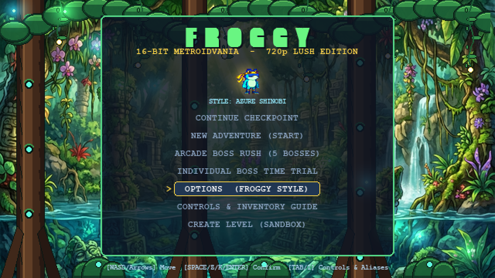
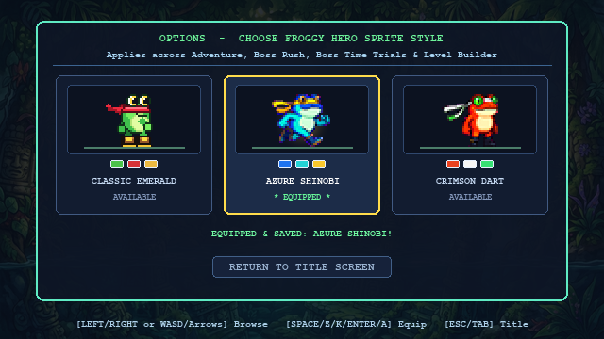
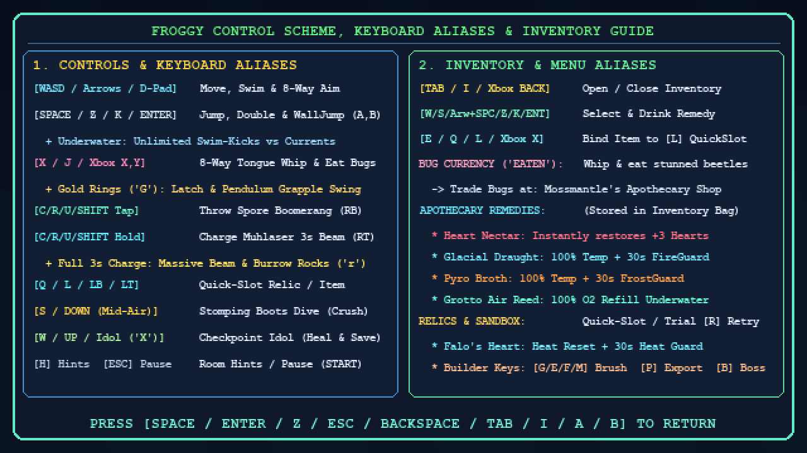
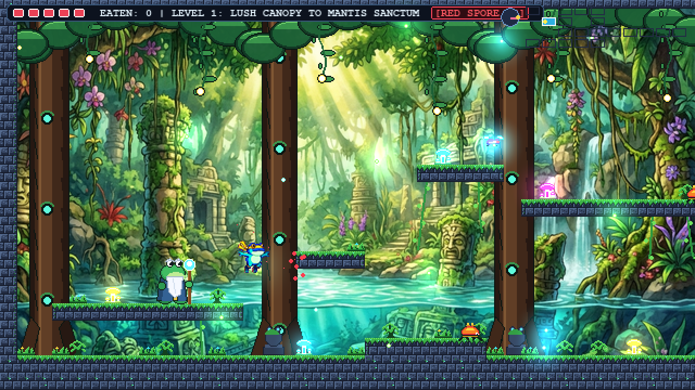
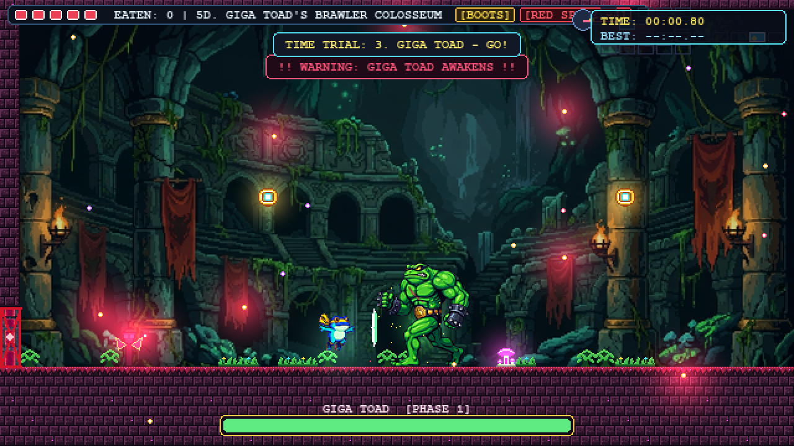
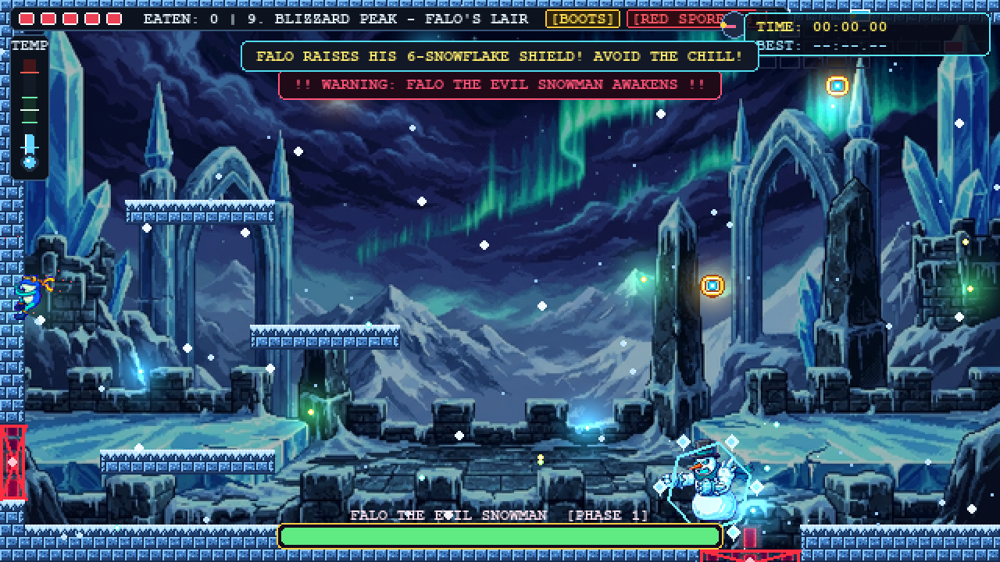
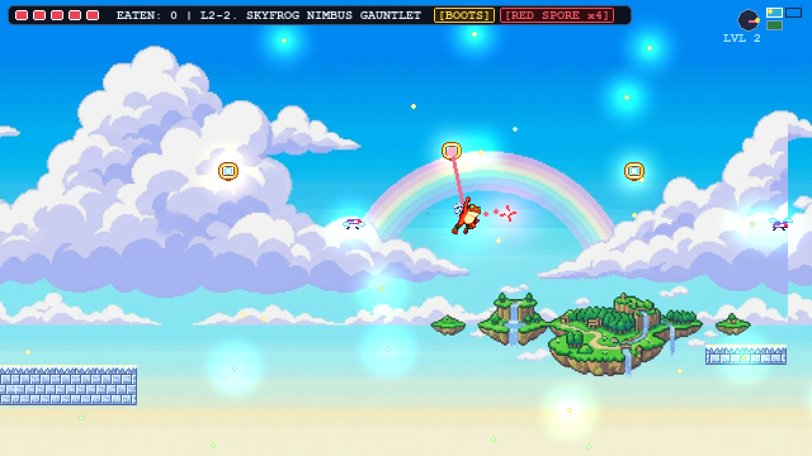

# Super Froggy: The Metroidvania Sanctuary Edition

A 16-bit SNES-inspired 2D action-platformer and Metroidvania built in Python with `pygame-ce`. Explore **23 interconnected zones** across **10 atmospheric biomes** (spanning Grid 1 Metroidvania realms and Grid 2 Skyfrog Tree & Nimbus gauntlets), swap between **3 selectable Froggy Hero Styles** in Main Menu -> Options, swing across chasms with Froggy's 360-degree tongue grapple, fire Spore Boomerangs and charged Muhlaser beams mid-swing, battle **5 redone Colossus Bosses** in Story, **Boss Rush**, or **Individual Boss Time Trials**, and customize every room or sprite using standalone developer studios.

---

## Gameplay Screenshots

| Title Screen & Main Menu | Hero Style Options (3 Selectable Styles) |
| :---: | :---: |
|  |  |
| **Control Scheme & Keyboard Aliases** | **Level 1: Lush Canopy Exploration** |
|  |  |
| **Boss Colosseum: Ultra-Jacked Giga Toad** | **Blizzard Peak: Falo's 6-Snowflake Shield** |
|  |  |

| Level 2 Skyfrog: Grapple Swing + Mid-Swing Boomerang (`Crimson Dart`) |
| :---: |
|  |

---

## Quick Start

```powershell
# Launch the full game (Title Screen, Story Mode, Options, Boss Rush & Boss Time Trials)
py main.py

# Or run the engine module directly
py froggy_engine.py
```

Requires Python 3.10+ with `pygame-ce` and `numpy` (`pillow` is used by the standalone generative sprite-sheet extraction scripts).

---

## Selectable Hero Styles (**Main Menu -> Options**)

Choose your Froggy Hero Style directly from **OPTIONS (FROGGY STYLE)** on the Title Screen (saved to `froggy_settings.json`, independent of `save_game.json`):

1. **Classic Emerald (`"classic"`)** — Original 16-bit green treefrog with crimson bandana and gold-trimmed boots (`assets/sprites/froggy_*.png`).
2. **Azure Shinobi (`"azure_shinobi"`, default)** — Generative 32-bit cobalt & turquoise ninja Froggy with saffron headband and brass-trimmed navy boots (`assets/sprites/styles/azure_shinobi/`).
3. **Crimson Dart (`"crimson_dart"`)** — Generative 32-bit scarlet poison-dart Froggy with ivory-and-emerald scarf and obsidian boots (`assets/sprites/styles/crimson_dart/`).

All 3 styles include complete `32x32` RGBA bottom-flush (`y=31`) animations across all 9 hero states (`idle`, `run`, `jump`, `fall`, `wall_slide`, `tongue`, `swim`, `swing`, `hurt`).

---

## Controls & Keyboard Aliases (`SNESController`)

Full keyboard aliases are also viewable in-game from **Main Menu -> Controls & Inventory Guide** (or pressing `Tab` / `I` / `Select` on the Title Screen):

| Action | Keyboard & Aliases | Controller |
| :--- | :--- | :--- |
| **Move / Swim / 8-Way Aim** | `W A S D` or `Arrow Keys` | D-Pad / Left Stick |
| **Jump / Double-Jump / Wall-Jump / Confirm** | `Space`, `Z`, `K`, `Enter` | `A` / `B` |
| **Tongue Whip / Grapple Swing / Eat Bugs** | `X`, `J` | `Y` / `X` |
| **Special (`[R]`)**: Spore Boomerang (tap) / Muhlaser (3s hold) | `C`, `R`, `U`, `Left Shift`, `Right Shift` | `RB` / `RT` |
| **Quick-Slot Relic / Remedy (`[L]`)** | `Q`, `L` | `LB` / `LT` |
| **Stomping Boots Dive** | `S` or `Down Arrow` (mid-air) | `Down` (mid-air) |
| **Checkpoint Idol / Enter Door** | `W` or `Up Arrow` (or touch) | `Up` |
| **Inventory & Gear Pouch** (also Controls on Title) | `Tab`, `I` | `Select` / `Back` |
| **Inventory: Equip Selected Item to `[L]` Quick-Slot** | `E`, `Q`, `L` | `X` / `LB` / `LT` |
| **Toggle Tactical Room Hints & Zone ID** | `H` | — |
| **Pause Menu / Back** | `Esc` (`Backspace` closes submenus) | `Start` |
| **Boss Time Trial Quick-Retry (on Victory)** | `R` | — |
| **Sandbox Builder Shortcuts** (`sandbox_room` only) | `L-Click` Paint, `R-Click` Erase, `G/E/F/M` Brush, `P` Export, `B` Boss Warp | — |

---

## World, Bosses & Key Relics

The world spans **23 zones** stored in `levels/*.json` across **2 Map Grids**:
- **Map Grid 1 (19 Adventure/Boss/Treasury zones + `sandbox_room`)**: Interconnected canopy, sunken temple, bioluminescent cavern, mantid sanctum, hound palace, glacial peaks (`ice`), volcanic magma chasm (`volcanic`), and deep trench (`underwater`).
- **Map Grid 2 (Level 2 — Skyfrog Realm)**: Unlocked when forging the Master Key; begins with `l2_tree_ascent` (3-screen vertical canopy ascent featuring horizontal screen wrap-around boundaries), leads into `l2_sky_grapples` (horizontal sky-grapple platforming with mid-swing Spore Boomerang & Muhlaser combat), and finishes at `l2_sky_summit`.

### 5 Colossus Bosses (**Story**, **Boss Rush**, & **Individual Boss Time Trials**)
1. **Emperor Mantis** (`boss_sanctum`, `7 HP`) — Redone generative sprite sheet, +15% faster across all 3 phases, aggressive Phase 3 speed & 5-way scythe spread; drops **Red Boomerang** and the **Mantis Master Key Fragment**.
2. **The Dread Hound** (`hound_sanctum`, `16 HP`) — Redone `96x96` sprite sheet, proximity-biased 50/50 Rush/Feint mixups, **Howl** attack erupting `HoundGroundSpike` hazards across the floor, and a full-screen Phase 3 **Flamethrower** sweep (avoidable via 5 high `'G'` grapple hooks); drops the **Hound Master Key Fragment**.
3. **Giga Toad** (`toad_colosseum`, `90 HP`) — Ultra-jacked `96x96` 31-frame generative Battletoad overhaul, +15% baseline & continuous missing-HP speed escalation, fearsome shockwave stomp SFX, and single-hit Championship Brawler Guard recovery; drops the **Toad Master Key Fragment**.
4. **Falo the Snowman** (`falo_arena`, `84 HP`) — Redone `64x64` sprite sheet, 6-Snowflake orbiting Ice Shield thrown one-by-one, `COLD_BEAM_RECHARGE`, persistent-until-touched geothermal heat vents (`'h'`) spawning from 6 choice locations, and a unified `0–200` **Thermometer** gauge (`TEMP`); drops **Falo's Heart** and the **Frost Shard Master Key Fragment**.
5. **Demon Shark** (`shark_sanctum`, `85 HP`) — Redone `96x64` sprite sheet, unstompable underwater, summons `AbyssalVortex` whirlpools impeding swimming, immune to self-stun in open water, vulnerable to the 3s Charged **Muhlaser**; drops the **Abyssal Pearl** (`has_abyssal_pearl`).

Collecting all **4 Master Key Fragments** from Bosses 1–4 assembles the **Master Key**, unsealing Gate `'L'` in `toad_colosseum` -> `victory_chamber` and opening **Level 2 (Skyfrog)**. From the Title Screen you can also launch **Individual Boss Time Trials** (equips Stomping Boots & Red Boomerang without Muhlaser and records per-boss Personal Bests in `boss_rush_records.json`).

### Core Relics & Locations
* **Stomping Boots (`'J'`)**: `entrance_hall` (2. Sunken Frog Temple Hall) — Dive-crush enemies & vulnerable bosses.
* **Red Boomerang (`'R'`)**: `boss_sanctum` (Emperor Mantis) — 4-way spore spread usable while swinging.
* **Vitality Heart Container (`'V'`)**: `grapple_cavern` — Permanently raises Max HP (+1 heart; *Life Talisman* also sold by Elder Mossmantle).
* **The Muhlaser (`'L'`)**: `hound_treasury` (5C. Vault of the Muhlaser) — 3-second `[R]` hold beam breaking Cracked Burrow Rocks (`'r'`).
* **Falo's Heart**: `falo_arena` — Quick-slot `[L]` resetting temperature to `100.0` + 30s Heat Guard.
* **Abyssal Pearl**: `shark_sanctum` — Grants infinite underwater Oxygen (`O2`).

---

## Companion Studios, Audio & Modding Tools

* **Multi-Section MIDI Soundtrack (`midi_writer.py`)**: Generates 17 full multi-section MIDI tracks (`assets/music/*.mid`) spanning 48–64 bars (~91–134 seconds per loop) with 43 16-bit WAV SFX samples in `assets/sfx/*.wav`.
* **Generative Sprite Pipelines (`process_froggy_sprites.py`, `process_boss_sprites.py`, `process_toad_sprites.py`)**: Extract chroma-keyed `#FF00FF` pixel-art sprite sheets cleanly into uniform RGBA PNGs.
* **Level Studio GUI & CLI (`level_studio.py`)**: Edit any of the 23 zones visually, preview all 10 biome themes, and press `F5` to playtest.
  ```powershell
  py level_studio.py                      # Launch Level Studio GUI
  py level_studio.py --list               # List all 23 zones
  py level_studio.py --play frost_springs # Playtest a specific zone directly
  ```
* **Sprite & Animation Inspector (`sprite_inspector.py`)**: Inspect 50 sequences (175 frames across all Froggy styles, enemies, bosses, tiles & props), 32-bit RGBA alpha pixels, flip (`F`), and floor anchoring.
  ```powershell
  py sprite_inspector.py                  # Launch Sprite Inspector GUI
  py sprite_inspector.py --list           # Print sequence & frame manifest
  py sprite_inspector.py --sprite run     # Inspect Froggy's sprint cycle
  ```
* **World Graph & Connectivity Validator (`map_tool.py`)**: Verify door links, boss/relic progression, and room reachability.
  ```powershell
  py map_tool.py                          # Full world audit & ASCII map
  py map_tool.py reach                    # BFS reachability & softlock check
  ```

---

## Documentation Index

* [`ARCHITECTURE_AND_LLM_GUIDE.md`](ARCHITECTURE_AND_LLM_GUIDE.md) — Engine architecture, class map, physics/biome systems, and safe AI-assisted modding guide.
* [`TOOLS_AND_MODULAR_GUIDE.md`](TOOLS_AND_MODULAR_GUIDE.md) — Complete CLI/GUI manual for `world_data.py`, `level_studio.py`, `sprite_inspector.py`, and `map_tool.py`.
* [`FROGGY_NEPHEW_EXPLAINER_AND_ROADMAP.md`](FROGGY_NEPHEW_EXPLAINER_AND_ROADMAP.md) — Step-by-step walkthrough of how retro rendering, physics, autotiling, and audio work under the hood.
